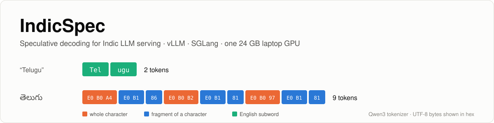
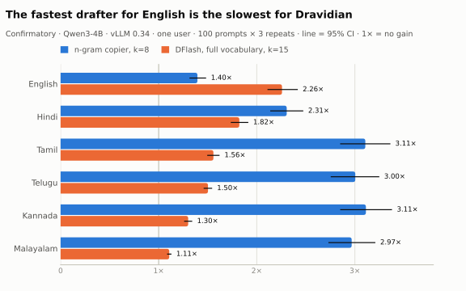
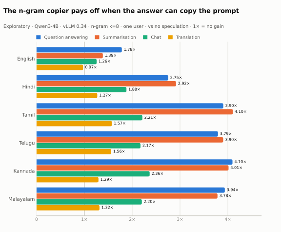
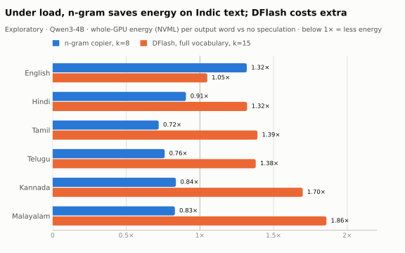
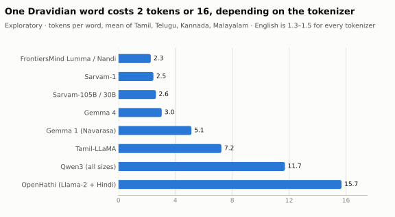
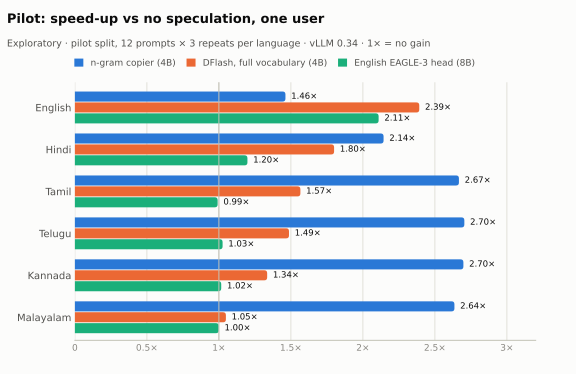
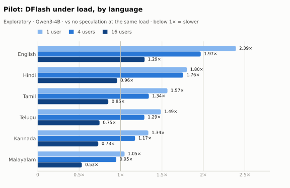
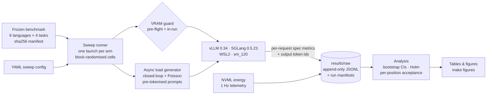

<div align="center">

<picture>
  <source media="(prefers-color-scheme: dark)" srcset="docs/assets/banner-dark.svg">
  
</picture>

**How well does speculative decoding survive Indic scripts, and why not?**<br>
EAGLE-3 · DFlash · n-gram drafters &nbsp;·&nbsp; vLLM · SGLang &nbsp;·&nbsp; Tamil · Telugu · Kannada · Malayalam · Hindi · English &nbsp;·&nbsp; one 24 GB laptop GPU

[](https://github.com/pratx1906/indicspec/actions/workflows/ci.yml)


[](LICENSE)

[Findings](#findings-so-far) · [Engineering](#engineering) · [Status](#engine--drafter-status) · [Reproduce](#quickstart) · [Roadmap](#roadmap) · [Docs](docs/README.md)

</div>

---

> [!NOTE]
> **Work in progress (November 2026).** Infrastructure, mechanism analysis, engine bring-up and the pilot are
> done and the [pre-registration is frozen](docs/PREREG.md); draft-length tuning is done, the correctness gate is
> [explained and amended](docs/PREREG.md#amendment-2-2026-11-26-after-the-correctness-gate-before-any-confirmatory-report-split-sweep),
> and the **Qwen3-4B confirmatory sweep is done** (results below). The **Qwen3-8B sweep is running** (288 cells,
> expected to finish on 28 November 2026); hypothesis H1 waits for it. An exploratory cross-model test adds 17 more
> open models, including Indian-built ones. Every number below says what it is and traces to a raw log or script
> ([claim ledger](docs/CLAIMS.md)). The confirmatory tests measure speed and acceptance; answer quality is checked
> only in the exploratory cross-model test. See [Limitations](#limitations).

## Why this matters

LLMs write one token at a time, and Indian-language text needs **6–7× more tokens than English** for the same
content, so Indic users wait and pay several times more per answer. *Speculative decoding* is the standard lossless
speed-up: a small drafter guesses the next tokens and the big model checks them in one pass. Its benefit depends on
how many guesses get accepted. IndicSpec measures whether that holds for Indic scripts in real serving engines,
under real load, and explains the answer down to the byte.

## Findings so far

### Headline · confirmatory results, Qwen3-4B

<picture>
  <source media="(prefers-color-scheme: dark)" srcset="docs/assets/confirm-speedup-dark.svg">
  
</picture>

Pre-registered tests on the held-out report split (100 parallel prompts × 3 repeats per cell, 32,400 requests,
0 cells excluded; [verdicts](results/tables/confirm_vllm_4b_verdicts.json); plain-language write-up:
[interim note](docs/REPORT/interim-qwen3-4b.md)):

- **The ranking of drafters flips with the language.** DFlash, the strongest learned drafter, is best on English
  (2.26×) but keeps only **46–66% of its English acceptance** on Tamil, Telugu, Kannada and Malayalam (H2
  falsified for DFlash). A model-free **n-gram copier gives ~3× on every Dravidian language**, more than twice
  its English gain (acceptance ratio vs English 2.46–2.59, H2 confirmed for n-gram).
- **Where speculation stops paying depends on the language (H4 confirmed).** DFlash stops helping at 8 concurrent
  users on Telugu, Kannada and Malayalam (16 on Tamil) but only at 32 on English. The n-gram copier never stops
  on Dravidian text up to 32 users; on English it stops at 8.
- **Gate G1 (a real language gap): YES.** **Gate G2 (mechanism): NO under the strict pre-registered rule**: for
  DFlash, re-weighting Dravidian positions to the English token-class mix explains essentially all of the gap;
  for the n-gram copier there is no gap to explain (Dravidian beats English), so the joint rule fails.
- Hypothesis H1 (pruned EAGLE-3 heads collapse) is tested on Qwen3-8B. That sweep is running; its verdicts will
  be added here when all 288 cells are in.
- **Not an engine quirk:** on SGLang 0.5.23, DFlash's acceptance matches vLLM's within 0.04 in every language
  ([C57](docs/CLAIMS.md)). The n-gram copier also favours Dravidian text there (1.7–1.9× vs 0.97× English),
  with more overhead than vLLM's. Along the way: **SGLang's n-gram drafter remembers earlier requests**, which
  inflated a repeated-prompt benchmark from 0.97× to 3.8× on English until the cache was flushed per cell
  ([D-023](docs/DECISIONS.md)).

<picture>
  <source media="(prefers-color-scheme: dark)" srcset="docs/assets/confirm-load-dark.svg">
  
</picture>

<details><summary>Table view and exploratory breakdowns</summary>

| Speed-up vs no speculation (95% CI) | en | hi | ta | te | kn | ml |
|---|---|---|---|---|---|---|
| n-gram k=8, 1 user | 1.40 [1.31, 1.48] | 2.31 [2.14, 2.47] | 3.11 [2.85, 3.36] | 3.00 [2.75, 3.25] | 3.11 [2.85, 3.38] | 2.97 [2.73, 3.21] |
| n-gram k=8, 8 users | 0.93 | 1.69 | 1.99 | 1.95 | 2.17 | 2.07 |
| n-gram k=8, 32 users | 0.65 | 1.04 | 1.19 | 1.22 | 1.52 | 1.22 |
| DFlash k=15, 1 user | 2.26 [2.11, 2.42] | 1.82 [1.74, 1.91] | 1.56 [1.49, 1.62] | 1.50 [1.46, 1.54] | 1.30 [1.26, 1.34] | 1.11 [1.09, 1.13] |
| DFlash k=15, 8 users | 1.33 | 1.16 | 1.00 | 0.96 | 0.88 | 0.76 |
| DFlash k=15, 32 users | 0.73 | 0.69 | 0.51 | 0.53 | 0.51 | 0.40 |
| Acceptance length, n-gram | 1.47 | 2.61 | 3.71 | 3.64 | 3.81 | 3.62 |
| Acceptance length, DFlash | 3.19 | 2.48 | 2.09 | 2.02 | 1.74 | 1.46 |

Exploratory (not pre-registered), from the same logs via `python -m indicspec.analysis.breakdown`:

- **By task:** the n-gram copier's Dravidian gain comes from tasks whose answers copy the prompt: QA 3.8–4.1×,
  summarisation 3.8–4.1×, chat 2.2–2.4×, translation only 1.3–1.6× (English translation 0.97×).
- **Energy:** at 16 users DFlash spends 1.4–1.9× the GPU energy per Dravidian word of no speculation, while the
  n-gram copier saves 16–28%. At one user, 100 Malayalam words cost 2,502 J without speculation vs 274 J for English.
- **Token classes:** DFlash accepts only 15% of whole-character tokens and ~33% of fragments in Malayalam (65% of
  English positions overall); the n-gram copier accepts 64–71% of Dravidian positions of every class.

Sources: [`confirm_vllm_4b_confirm.csv`](results/tables/confirm_vllm_4b_confirm.csv),
[`_by_task.csv`](results/tables/confirm_vllm_4b_by_task.csv), [`_energy.csv`](results/tables/confirm_vllm_4b_energy.csv),
[`_class_acceptance.csv`](results/tables/confirm_vllm_4b_class_acceptance.csv) · claims C52–C56, C59

<picture>
  <source media="(prefers-color-scheme: dark)" srcset="docs/assets/confirm-tasks-dark.svg">
  
</picture>

<picture>
  <source media="(prefers-color-scheme: dark)" srcset="docs/assets/confirm-energy-dark.svg">
  
</picture>
</details>

### Beyond Qwen: the tokenizer decides (exploratory)

<picture>
  <source media="(prefers-color-scheme: dark)" srcset="docs/assets/crossmodel-tokens-dark.svg">
  
</picture>

A quick test of 18 open models (17 ran; Indian-built ones included) asked whether the confirmatory n-gram result is
a Qwen quirk ([D-025](docs/DECISIONS.md); 10–20 items per language, so a direction, not a verdict):

- **The token tax is a tokenizer choice.** One Dravidian word costs 2.3 tokens with FrontiersMind's Lumma,
  2.5–2.6 with Sarvam's, 3.0 with Gemma 4 and 11.7 with Qwen3 ([C60](docs/CLAIMS.md)).
- **The n-gram drafter's Dravidian advantage follows it.** Among models that answer reliably, its gain on
  Dravidian text relative to English falls from 2.2 (Qwen3-4B) to 1.7 (Navarasa) to 1.1 (Gemma 4) as words
  get cheaper ([C61](docs/CLAIMS.md)). The confirmatory n-gram result is largely a property of the Qwen
  tokenizer.
- **Cheap tokens are not the same as good answers.** Gemma 4 E4B gives the best Indian-language answers
  here (QA 0.6–1.0, never cut off). Qwen3-4B answers well but hits a 1,024-token limit in 15–30% of Indian
  answers. Lumma-0.6B has the most efficient tokenizer but repeats the English prompt in 60% of
  Indian-language translations ([C63](docs/CLAIMS.md)).

<details><summary>Table view</summary>

| Model | Tokens per Dravidian word | n-gram gain, Dravidian ÷ English | Indian-language answers |
|---|---|---|---|
| Qwen3-4B | 11.7 | 2.16 | reliable; 15–30% cut off at 1,024 tokens |
| Navarasa-2.0 (Gemma-7B + Indic data) | 5.1 | 1.67 | reliable |
| Gemma 4 E4B | 3.0 | 1.07 | reliable, best quality |
| Sarvam-1 (base) | 2.5 | 1.21 | 36% of translations untranslated |
| Lumma-0.6B (FrontiersMind) | 2.3 | 1.46 (transformers) | 60% of translations untranslated |

Sources: [`crossmodel_tokens.csv`](results/tables/crossmodel_tokens.csv),
[`crossmodel_summary.csv`](results/tables/crossmodel_summary.csv) · claims C60–C63
</details>

### 1 · The token tax

<picture>
  <source media="(prefers-color-scheme: dark)" srcset="docs/assets/token-tax-dark.svg">
  
</picture>

<details><summary>Table view</summary>

| | en | hi | ta | te | kn | ml |
|---|---|---|---|---|---|---|
| Tokens vs English (95% CI) | 1.00 | 4.46 [4.38, 4.54] | 6.18 [6.06, 6.30] | 7.02 [6.88, 7.15] | 6.95 [6.81, 7.09] | 7.31 [7.17, 7.46] |
| Tokens per word | 1.26 | 4.78 | 10.14 | 11.41 | 11.85 | 13.43 |

Source: [`results/tables/token_tax.csv`](results/tables/token_tax.csv) · status `MEASURED` (claim C22)
</details>

Side finding: **Qwen3 ships exactly the Qwen2.5 tokenizer** (same vocabulary and all 151,387 merges; four new special
tokens), so published Qwen2.5 token-tax figures carry over, and these numbers independently reproduce them.

### 2 · Most Dravidian tokens are fragments of a character

<picture>
  <source media="(prefers-color-scheme: dark)" srcset="docs/assets/fragmentation-dark.svg">
  
</picture>

Qwen3's 151k-token vocabulary has only **14 whole Telugu characters** (Tamil 28, Kannada 25, Malayalam 32) and **no**
multi-character Dravidian tokens, so most letters are emitted as partial UTF-8 sequences, exactly like the
`E0 B1` + `86` pairs in the banner above. Source: [`fragmentation_ref.csv`](results/tables/fragmentation_ref.csv).

### 3 · Pruned-vocabulary drafters hit a hard ceiling

<picture>
  <source media="(prefers-color-scheme: dark)" srcset="docs/assets/ceiling-dark.svg">
  
</picture>

EAGLE-3 heads draft over a pruned 32k vocabulary. Reading the id maps straight from the checkpoints, both public
Qwen3-8B heads can propose **~0% of the tokens that start a Dravidian character**. Even a perfect drafter is then
capped at **1.46–1.75 tokens per step on Dravidian text, and drafting more tokens does not help**: every character
boundary cuts the run. Rebuilding the vocabulary for Hindi fixes Hindi (100% coverage) but does not transfer.

<details><summary>Table view</summary>

| Ceiling, tokens per step | en | hi | ta | te | kn | ml |
|---|---|---|---|---|---|---|
| English EAGLE-3 head, 3 draft tokens | 3.51 | 2.89 | 1.46 | 1.63 | 1.53 | 1.66 |
| English EAGLE-3 head, 7 draft tokens | 6.05 | 4.09 | 1.46 | 1.64 | 1.53 | 1.66 |
| Hindi/Gujarati EAGLE-3 head, 7 draft tokens | 6.52 | 7.87 | 1.63 | 1.75 | 1.61 | 1.75 |
| Any full-vocabulary drafter, 7 draft tokens | 7.55 | 7.88 | 7.91 | 7.92 | 7.92 | 7.93 |

Upper bound on reference text, not engine measurements · source: [`oracle_tau_bound.csv`](results/tables/oracle_tau_bound.csv) (claim C39)
</details>

### 4 · Baselines verified before any comparison

A drafter only counts once it reproduces its authors' English behaviour on this hardware:

| English configuration check | This repo | Authors |
|---|---|---|
| DFlash on Qwen3-8B, vLLM 0.34 | **5.51** | 4.9 mean |
| DFlash on Qwen3-8B, SGLang 0.5.23 | **5.51** | 4.9 mean |
| Red Hat EAGLE-3 head, 3 draft tokens | **2.68** | 2.13–2.48 |


### 5 · Pilot: three drafter families, three different behaviours (exploratory)

> [!IMPORTANT]
> Pilot split only: 12 parallel prompts per language × 3 repeats, used to set the
> [frozen pre-registration](docs/PREREG.md). These are **not** confirmatory results; the report-split runs
> (100 prompts × 3 repeats per cell, tuned draft lengths) decide them.

<picture>
  <source media="(prefers-color-scheme: dark)" srcset="docs/assets/pilot-speedup-dark.svg">
  
</picture>

- **The English EAGLE-3 head gives no speed-up on Dravidian text** (0.99–1.03×; acceptance 1.15–1.20), sitting
  under the coverage ceiling it was predicted to hit. The Hindi/Gujarati head reproduces its own model card
  (Hindi 2.01, English 1.49).
- **DFlash, the strongest full-vocabulary drafter, loses most of its benefit** (English 2.39×, Dravidian
  1.05–1.57×), so vocabulary coverage is not the whole story.
- **A model-free n-gram copier does best on Dravidian text** (2.64–2.70×, acceptance 2.6–2.9) and worst on English.

<picture>
  <source media="(prefers-color-scheme: dark)" srcset="docs/assets/pilot-load-dark.svg">
  
</picture>

Under load the gap widens: at 16 concurrent users **DFlash makes every Indic language slower than not
speculating** (Malayalam 0.53×) while English still gains 1.29×; the n-gram copier keeps 2.0–2.3× on Dravidian
text. Energy follows: with no speculation, 100 words of Malayalam cost ~10× the GPU energy of 100 English words
(2,495 J vs 260 J, one user); the n-gram copier cuts Dravidian energy per word by 55–60%.

<details><summary>Table view (pilot, Qwen3-4B unless noted)</summary>

| Speed-up vs no speculation | en | hi | ta | te | kn | ml |
|---|---|---|---|---|---|---|
| n-gram, 1 user | 1.46 | 2.14 | 2.67 | 2.70 | 2.70 | 2.64 |
| n-gram, 16 users | 1.24 | 1.61 | 2.30 | 2.19 | 2.07 | 2.03 |
| DFlash, 1 user | 2.39 | 1.80 | 1.57 | 1.49 | 1.34 | 1.05 |
| DFlash, 4 users | 1.97 | 1.76 | 1.34 | 1.29 | 1.17 | 0.95 |
| DFlash, 16 users | 1.29 | 0.96 | 0.85 | 0.75 | 0.73 | 0.53 |
| English EAGLE-3 (8B), 1 user | 2.11 | 1.20 | 0.99 | 1.03 | 1.02 | 1.00 |
| Hindi/Gujarati EAGLE-3 (8B), 1 user | 1.26 | 1.65 | 0.95 | 1.09 | 1.01 | 0.93 |
| DFlash (8B), 1 user | 2.22 | 1.84 | 1.32 | 1.11 | 1.27 | 0.96 |

Sources: [`pilot_vllm_4b_noise.csv`](results/tables/pilot_vllm_4b_noise.csv),
[`pilot_vllm_8b_noise.csv`](results/tables/pilot_vllm_8b_noise.csv) (paired bootstrap CIs per cell);
raw logs under [`results/raw/pilot_vllm_4b`](results/raw/pilot_vllm_4b) and
[`results/raw/pilot_vllm_8b`](results/raw/pilot_vllm_8b).
</details>

## Engineering



| | |
|---|---|
| **Per-request acceptance on both engines** | vLLM `metrics.speculative_decoding` and SGLang `sglext.spec_tokens_details`, so acceptance is per language, not pooled. Engines define "acceptance length" differently (SGLang's own figure read 5.72 where its raw counters give 5.51), so every τ is recomputed as `(accepted + steps) / steps`. |
| **Engine-truth mechanism analysis** | vLLM's per-step accept counts + streamed token ids reconstruct which token each rejection happened on (alignment verified against token counts), answering *"did the drafter fail on a token outside its vocabulary?"* from the production engine, not a re-implementation. |
| **No OOM, no silent spill** | On WSL the driver can spill VRAM into system RAM and silently corrupt timing. A guard refuses launches that do not fit in free VRAM and invalidates runs that touch the ceiling. It caught SGLang at 24.1 / 24.5 GB. |
| **Fair comparisons** | Same pre-tokenised prompts, `max_num_seqs` and memory policy for every arm including the baseline; repeats in seeded shuffled order so laptop thermal drift cannot align with one arm; GPU energy per cell from the NVML counter. |
| **Reproducible & auditable** | Pinned model, drafter and dataset revisions; checksummed benchmark (`make data`); engine lockfiles; a run manifest per launch; [claim ledger](docs/CLAIMS.md); thresholds [pre-registered](docs/PREREG.md) before confirmatory runs. |

<details><summary><b>Bring-up notes from this GPU</b> (what broke and why)</summary>

- **Qwen3-8B + an EAGLE-3 head left 0.35 GiB of KV cache** on 24 GB with default `max_num_seqs`. Capping it at the
  design's maximum concurrency (32), for every arm, fixed it.
- **SGLang's `--mem-fraction-static` covers weights + KV only**; CUDA graphs and activations come on top, so it
  needs far more headroom than vLLM's `gpu_memory_utilization`.
- **The public English EAGLE-3 head uses the *speculators* format with `norm_before_residual: true`**, which SGLang
  0.5.23 does not implement. Converting it would silently run a different network, so it is measured on vLLM only.
- **vLLM 0.34's v2 model runner needs `VLLM_WSL2_ENABLE_PIN_MEMORY=1`** under WSL2; SGLang needs its venv on `PATH`
  to JIT-compile kernels with `ninja`.
- **`nvidia-smi` has no total-energy field on this driver, but NVML's counter works.** The GPU's power cap depends on
  the laptop's power mode (175 W in Turbo, 55 W in Silent). Every manifest records the enforced cap, and sweeps
  refuse to start below 140 W.

Full record: [`docs/ENGINE_STATUS.md`](docs/ENGINE_STATUS.md) · [`docs/DECISIONS.md`](docs/DECISIONS.md)
</details>

## Engine × drafter status

On an NVIDIA RTX 5090 Laptop GPU (24 GB, `sm_120`), Qwen3 in bf16:

| Arm | Drafter | vLLM 0.34.0 | SGLang 0.5.23 |
|---|---|:---:|:---:|
| A0 | none (baseline), Qwen3-4B / 8B | ✅ ✅ | ✅ ✅ |
| A1 | engine n-gram | ✅ | ✅ |
| A3 | [`RedHatAI/Qwen3-8B-speculator.eagle3`](https://huggingface.co/RedHatAI/Qwen3-8B-speculator.eagle3), English, pruned vocab | ✅ | ❌ [unsupported variant](docs/ENGINE_STATUS.md) |
| A4 | [`SwitchXDDD/multilingual-eagle3-qwen3-8b`](https://huggingface.co/SwitchXDDD/multilingual-eagle3-qwen3-8b), Hindi/Gujarati, pruned vocab | ✅ | ✅ |
| A5 | [`z-lab/Qwen3-{4B,8B}-DFlash-b16`](https://huggingface.co/z-lab/Qwen3-8B-DFlash-b16), full vocab | ✅ ✅ | ✅ ✅ |

## Quickstart

```bash
git clone https://github.com/pratx1906/indicspec && cd indicspec
uv sync --extra analysis --extra data
make test           # CPU unit + property tests (what CI runs)
make data           # rebuild IndicSpec-Bench from pinned sources, verify sha256
make figures        # regenerate the charts above from results/tables

# GPU, inside Linux or WSL2
bash env/install_engines.sh all                   # vLLM and SGLang in separate venvs
bash scripts/smoke.sh vllm A5 qwen3-8b            # one arm, six languages
bash scripts/sweep.sh configs/pilot_vllm_4b.yaml  # a full sweep (resumable)
```

## Repository layout

```text
indicspec/
├── src/indicspec/
│   ├── tokens/      byte-level BPE decoding · token classes · EAGLE-3 draft-vocab maps · safetensors reader
│   ├── harness/     server launcher · VRAM guard · load generator · sweep runner · telemetry · equality checks
│   ├── analysis/    token tax · coverage · oracle ceiling · per-position acceptance · pilot noise ·
│   │                tuning · confirmatory tests · figures
│   └── data/        IndicSpec-Bench builders (FLORES via IndicGenBench · XQuAD-IN · Belebele · Aya)
├── configs/         pinned models, arms, engines, data sources, sweep configs
├── schemas/         JSON Schemas for request logs and run manifests
├── results/         raw/ append-only logs · tables/ generated
├── docs/            brief · plan · pre-registration · claim ledger · decisions · engine status · assets/
├── tests/           unit · property · data (pytest markers: gpu, slow, data)
├── env/             engine install script and lockfiles
└── scripts/         smoke, sweep, probe and figure runners
```

## Roadmap

- [x] Scaffold, CI, environment probe, claim ledger
- [x] IndicSpec-Bench: 6 languages × 4 tasks, parallel items, pilot / tuning / report splits, checksummed
- [x] Token tax, fragmentation, draft-vocab coverage, oracle ceiling
- [x] Engine bring-up on `sm_120`, smoke matrix, English configuration checks (Gate G0 passed)
- [x] Pilot sweeps (pilot split) → [pre-registration frozen](docs/PREREG.md) before any confirmatory run
- [x] Draft-length tuning per drafter on the tuning split ([D-020](docs/DECISIONS.md))
- [x] Greedy-equality gate: failures traced to bf16 near-tie flips (the plain model shows them too under a
      different batch shape); rule amended before any confirmatory data ([D-021](docs/DECISIONS.md))
- [x] Confirmatory sweep, Qwen3-4B (vLLM): H2, H3, H4, G1, G2 ([verdicts](results/tables/confirm_vllm_4b_verdicts.json))
- [ ] Confirmatory sweep, Qwen3-8B (vLLM): H1 and the second model size &nbsp;*(running)*
- [x] Cross-engine check on SGLang (DFlash acceptance, n-gram) ([C57](docs/CLAIMS.md))
- [x] Exploratory cross-model test: 17 more open models, tokenizers, n-gram gain, answer quality ([D-025](docs/DECISIONS.md))
- [ ] SGLang confirmatory sweeps (secondary engine) · Poisson arrivals
- [ ] Coverage-split and class-level acceptance from engine traces (H1–H3)
- [ ] Load crossover per language (H4) · Nsight-backed cost model
- [ ] Sampling-distribution correctness suite for every reported arm
- [ ] If the gates justify it: byte-aware n-gram drafter · UTF-8-validity draft mask

## Related work

Closest prior work: phrase-level speculative decoding with Telugu/Kannada/Hindi results on Qwen3-4B
([arXiv 2611.12464](https://arxiv.org/abs/2611.12464)); dictionary n-gram drafting for high-fertility scripts
([DictSpec, UNLP 2026](https://aclanthology.org/2026.unlp-1.15/)); a Hindi/Gujarati EAGLE-3 head
([SwitchXDDD](https://huggingface.co/SwitchXDDD/multilingual-eagle3-qwen3-8b)); SPEED-Bench
([arXiv 2604.09557](https://arxiv.org/abs/2604.09557)); DFlash ([arXiv 2602.06036](https://arxiv.org/abs/2602.06036)).
IndicSpec evaluates the drafters people deploy, in production engines under load, on all four Dravidian languages
with parallel content, and explains the results at the byte level. Search log: [`docs/NOVELTY_LOG.md`](docs/NOVELTY_LOG.md).

## Limitations

- **Hardware:** one consumer laptop GPU (RTX 5090 Laptop, 24 GB, capped at 175 W) under WSL2, so absolute speeds
  will differ on data-centre GPUs. Ratios between drafters and languages are the main result, and it is not yet
  tested whether they transfer.
- **Models:** the confirmatory tests cover one model family (Qwen3, 4B and 8B). The cross-model test of 17 more open
  models is exploratory: 10–20 items per language, no confidence intervals. Two FrontiersMind models ran in
  transformers because vLLM does not support them.
- **Engines and load:** vLLM is the primary engine. SGLang is only a cross-check, not a confirmatory sweep. Load is
  closed-loop (each user sends a new request when the last one finishes); Poisson arrivals are not yet tested.
- **Decoding:** greedy (temperature 0), Qwen3 thinking mode off, at most 256 new tokens per answer. At 256 tokens a
  Dravidian answer holds roughly a tenth as many words as an English one, so per-language outputs cover different
  amounts of content. Sampling (temperature above 0) is not tested.
- **"Lossless" up to bf16 rounding:** speculative outputs can differ from plain decoding where the top two tokens are
  nearly tied. The plain model differs from itself the same way under a different batch shape
  ([Amendment 2](docs/PREREG.md#amendment-2-2026-11-26-after-the-correctness-gate-before-any-confirmatory-report-split-sweep)).
- **Answer quality:** not measured in the confirmatory tests. The cross-model quality check uses automatic proxies
  (gold answer present, chrF, correct script), not human judgement.
- **Ceilings on reference text:** the coverage and oracle ceilings in finding 3 are computed on reference text, not
  on model outputs, so they are upper bounds.
- **Energy:** GPU board energy only (NVML), not the whole system.
- **Benchmark:** four tasks, about 100 report prompts per language. The chat prompts are machine-translated, carry
  translationese risk, and still need native-speaker review.

## Licence and citation

Code is released under the [Apache License 2.0](LICENSE). Benchmark sources keep their own licences
(CC-BY-SA-4.0, Apache-2.0); this repo ships builders and checksums, not their text. Cite via
[`CITATION.cff`](CITATION.cff).
