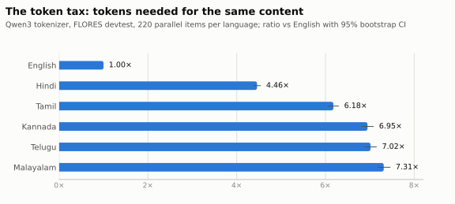
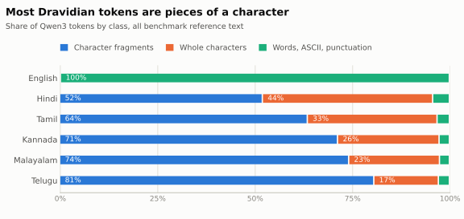
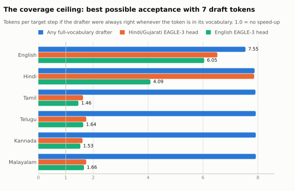
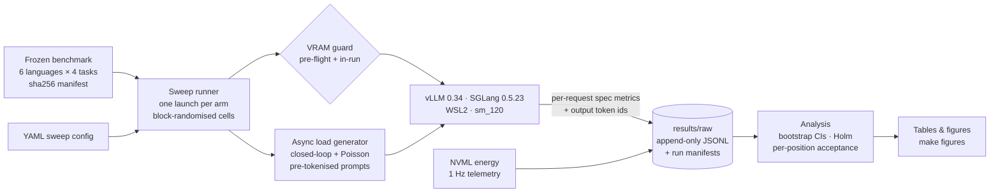

<div align="center">

<picture>
  <source media="(prefers-color-scheme: dark)" srcset="docs/assets/banner-dark.svg">
  
</picture>

**How well does speculative decoding survive Indic scripts, and why not?**<br>
EAGLE-3 · DFlash · n-gram drafters &nbsp;·&nbsp; vLLM · SGLang &nbsp;·&nbsp; Tamil · Telugu · Kannada · Malayalam · Hindi · English &nbsp;·&nbsp; one 24 GB laptop GPU

[](https://github.com/pratx1906/indicspec/actions/workflows/ci.yml)


[](LICENSE)

[Findings](#findings-so-far) · [Engineering](#engineering) · [Status](#engine--drafter-status) · [Reproduce](#quickstart) · [Roadmap](#roadmap) · [Docs](docs/README.md)

</div>

---

> [!NOTE]
> **Work in progress (November 2026).** Infrastructure, mechanism analysis and engine bring-up are done; the
> pre-registered confirmatory runs have not happened yet. Every number below says what it is and traces to a raw
> log or script ([claim ledger](docs/CLAIMS.md)). Speed and acceptance only: **answer quality is not measured.**

## Why this matters

LLMs write one token at a time, and Indian-language text needs **6–7× more tokens than English** for the same
content, so Indic users wait and pay several times more per answer. *Speculative decoding* is the standard lossless
speed-up: a small drafter guesses the next tokens and the big model checks them in one pass. Its benefit depends on
how many guesses get accepted. IndicSpec measures whether that holds for Indic scripts in real serving engines,
under real load, and explains the answer down to the byte.

## Findings so far

### 1 · The token tax

<picture>
  <source media="(prefers-color-scheme: dark)" srcset="docs/assets/token-tax-dark.svg">
  
</picture>

<details><summary>Table view</summary>

| | en | hi | ta | te | kn | ml |
|---|---|---|---|---|---|---|
| Tokens vs English (95% CI) | 1.00 | 4.46 [4.38, 4.54] | 6.18 [6.06, 6.30] | 7.02 [6.88, 7.15] | 6.95 [6.81, 7.09] | 7.31 [7.17, 7.46] |
| Tokens per word | 1.26 | 4.78 | 10.14 | 11.41 | 11.85 | 13.43 |

Source: [`results/tables/token_tax.csv`](results/tables/token_tax.csv) · status `MEASURED` (claim C22)
</details>

Side finding: **Qwen3 ships exactly the Qwen2.5 tokenizer** (same vocabulary and all 151,387 merges; four new special
tokens), so published Qwen2.5 token-tax figures carry over, and these numbers independently reproduce them.

### 2 · Most Dravidian tokens are fragments of a character

<picture>
  <source media="(prefers-color-scheme: dark)" srcset="docs/assets/fragmentation-dark.svg">
  
</picture>

Qwen3's 151k-token vocabulary has only **14 whole Telugu characters** (Tamil 28, Kannada 25, Malayalam 32) and **no**
multi-character Dravidian tokens, so most letters are emitted as partial UTF-8 sequences, exactly like the
`E0 B1` + `86` pairs in the banner above. Source: [`fragmentation_ref.csv`](results/tables/fragmentation_ref.csv).

### 3 · Pruned-vocabulary drafters hit a hard ceiling

<picture>
  <source media="(prefers-color-scheme: dark)" srcset="docs/assets/ceiling-dark.svg">
  
</picture>

EAGLE-3 heads draft over a pruned 32k vocabulary. Reading the id maps straight from the checkpoints, both public
Qwen3-8B heads can propose **~0% of the tokens that start a Dravidian character**. Even a perfect drafter is then
capped at **1.46–1.75 tokens per step on Dravidian text, and drafting more tokens does not help**: every character
boundary cuts the run. Rebuilding the vocabulary for Hindi fixes Hindi (100% coverage) but does not transfer.

<details><summary>Table view</summary>

| Ceiling, tokens per step | en | hi | ta | te | kn | ml |
|---|---|---|---|---|---|---|
| English EAGLE-3 head, 3 draft tokens | 3.51 | 2.89 | 1.46 | 1.63 | 1.53 | 1.66 |
| English EAGLE-3 head, 7 draft tokens | 6.05 | 4.09 | 1.46 | 1.64 | 1.53 | 1.66 |
| Hindi/Gujarati EAGLE-3 head, 7 draft tokens | 6.52 | 7.87 | 1.63 | 1.75 | 1.61 | 1.75 |
| Any full-vocabulary drafter, 7 draft tokens | 7.55 | 7.88 | 7.91 | 7.92 | 7.92 | 7.93 |

Upper bound on reference text, not engine measurements · source: [`oracle_tau_bound.csv`](results/tables/oracle_tau_bound.csv) (claim C39)
</details>

### 4 · Baselines verified before any comparison

A drafter only counts once it reproduces its authors' English behaviour on this hardware:

| English configuration check | This repo | Authors |
|---|---|---|
| DFlash on Qwen3-8B, vLLM 0.34 | **5.51** | 4.9 mean |
| DFlash on Qwen3-8B, SGLang 0.5.23 | **5.51** | 4.9 mean |
| Red Hat EAGLE-3 head, 3 draft tokens | **2.68** | 2.13–2.48 |

Smoke runs on Indic prompts point to a large gap even for full-vocabulary DFlash; that is what the confirmatory
runs will test.

## Engineering



| | |
|---|---|
| **Per-request acceptance on both engines** | vLLM `metrics.speculative_decoding` and SGLang `sglext.spec_tokens_details`, so acceptance is per language, not pooled. Engines define "acceptance length" differently (SGLang's own figure read 5.72 where its raw counters give 5.51), so every τ is recomputed as `(accepted + steps) / steps`. |
| **Engine-truth mechanism analysis** | vLLM's per-step accept counts + streamed token ids reconstruct which token each rejection happened on (alignment verified against token counts), answering *"did the drafter fail on a token outside its vocabulary?"* from the production engine, not a re-implementation. |
| **No OOM, no silent spill** | On WSL the driver can spill VRAM into system RAM and silently corrupt timing. A guard refuses launches that do not fit in free VRAM and invalidates runs that touch the ceiling. It caught SGLang at 24.1 / 24.5 GB. |
| **Fair comparisons** | Same pre-tokenised prompts, `max_num_seqs` and memory policy for every arm including the baseline; repeats in seeded shuffled order so laptop thermal drift cannot align with one arm; GPU energy per cell from the NVML counter. |
| **Reproducible & auditable** | Pinned model, drafter and dataset revisions; checksummed benchmark (`make data`); engine lockfiles; a run manifest per launch; [claim ledger](docs/CLAIMS.md); thresholds [pre-registered](docs/PREREG.md) before confirmatory runs. |

<details><summary><b>Bring-up notes from this GPU</b> (what broke and why)</summary>

- **Qwen3-8B + an EAGLE-3 head left 0.35 GiB of KV cache** on 24 GB with default `max_num_seqs`. Capping it at the
  design's maximum concurrency (32), for every arm, fixed it.
- **SGLang's `--mem-fraction-static` covers weights + KV only**; CUDA graphs and activations come on top, so it
  needs far more headroom than vLLM's `gpu_memory_utilization`.
- **The public English EAGLE-3 head uses the *speculators* format with `norm_before_residual: true`**, which SGLang
  0.5.23 does not implement. Converting it would silently run a different network, so it is measured on vLLM only.
- **vLLM 0.34's v2 model runner needs `VLLM_WSL2_ENABLE_PIN_MEMORY=1`** under WSL2; SGLang needs its venv on `PATH`
  to JIT-compile kernels with `ninja`.
- **`nvidia-smi` has no total-energy field on this driver, but NVML's counter works**, and the laptop enforces a
  150 W cap that every manifest records.

Full record: [`docs/ENGINE_STATUS.md`](docs/ENGINE_STATUS.md) · [`docs/DECISIONS.md`](docs/DECISIONS.md)
</details>

## Engine × drafter status

On an NVIDIA RTX 5090 Laptop GPU (24 GB, `sm_120`), Qwen3 in bf16:

| Arm | Drafter | vLLM 0.34.0 | SGLang 0.5.23 |
|---|---|:---:|:---:|
| A0 | none (baseline), Qwen3-4B / 8B | ✅ ✅ | ✅ ✅ |
| A1 | engine n-gram | ✅ | ✅ |
| A3 | [`RedHatAI/Qwen3-8B-speculator.eagle3`](https://huggingface.co/RedHatAI/Qwen3-8B-speculator.eagle3), English, pruned vocab | ✅ | ❌ [unsupported variant](docs/ENGINE_STATUS.md) |
| A4 | [`SwitchXDDD/multilingual-eagle3-qwen3-8b`](https://huggingface.co/SwitchXDDD/multilingual-eagle3-qwen3-8b), Hindi/Gujarati, pruned vocab | ✅ | ✅ |
| A5 | [`z-lab/Qwen3-{4B,8B}-DFlash-b16`](https://huggingface.co/z-lab/Qwen3-8B-DFlash-b16), full vocab | ✅ ✅ | ✅ ✅ |

## Quickstart

```bash
git clone https://github.com/pratx1906/indicspec && cd indicspec
uv sync --extra analysis --extra data
make test           # CPU unit + property tests (what CI runs)
make data           # rebuild IndicSpec-Bench from pinned sources, verify sha256
make figures        # regenerate the charts above from results/tables

# GPU, inside Linux or WSL2
bash env/install_engines.sh all                   # vLLM and SGLang in separate venvs
bash scripts/smoke.sh vllm A5 qwen3-8b            # one arm, six languages
bash scripts/sweep.sh configs/pilot_vllm_4b.yaml  # a full sweep (resumable)
```

## Repository layout

```text
indicspec/
├── src/indicspec/
│   ├── tokens/      byte-level BPE decoding · token classes · EAGLE-3 draft-vocab maps · safetensors reader
│   ├── harness/     server launcher · VRAM guard · load generator · sweep runner · telemetry · equality checks
│   ├── analysis/    token tax · coverage · oracle ceiling · per-position acceptance · pilot noise · figures
│   └── data/        IndicSpec-Bench builders (FLORES via IndicGenBench · XQuAD-IN · Belebele · Aya)
├── configs/         pinned models, arms, engines, data sources, sweep configs
├── schemas/         JSON Schemas for request logs and run manifests
├── results/         raw/ append-only logs · tables/ generated
├── docs/            brief · plan · pre-registration · claim ledger · decisions · engine status · assets/
├── tests/           unit · property · data (pytest markers: gpu, slow, data)
├── env/             engine install script and lockfiles
└── scripts/         smoke, sweep, probe and figure runners
```

## Roadmap

- [x] Scaffold, CI, environment probe, claim ledger
- [x] IndicSpec-Bench: 6 languages × 4 tasks, parallel items, pilot / tuning / report splits, checksummed
- [x] Token tax, fragmentation, draft-vocab coverage, oracle ceiling
- [x] Engine bring-up on `sm_120`, smoke matrix, English configuration checks (Gate G0 passed)
- [ ] Pilot → freeze pre-registered thresholds &nbsp;*(running)*
- [ ] Confirmatory sweeps: acceptance and speed-up per language, concurrency 1–32, closed-loop + Poisson
- [ ] Coverage-split and class-level acceptance from engine traces (H1–H3)
- [ ] Load crossover per language (H4) · Nsight-backed cost model
- [ ] Greedy-equality and sampling-distribution correctness suite for every reported arm
- [ ] If the gates justify it: byte-aware n-gram drafter · UTF-8-validity draft mask

## Related work

Closest prior work: phrase-level speculative decoding with Telugu/Kannada/Hindi results on Qwen3-4B
([arXiv 2611.12464](https://arxiv.org/abs/2611.12464)); dictionary n-gram drafting for high-fertility scripts
([DictSpec, UNLP 2026](https://aclanthology.org/2026.unlp-1.15/)); a Hindi/Gujarati EAGLE-3 head
([SwitchXDDD](https://huggingface.co/SwitchXDDD/multilingual-eagle3-qwen3-8b)); SPEED-Bench
([arXiv 2604.09557](https://arxiv.org/abs/2604.09557)); DFlash ([arXiv 2602.06036](https://arxiv.org/abs/2602.06036)).
IndicSpec evaluates the drafters people deploy, in production engines under load, on all four Dravidian languages
with parallel content, and explains the results at the byte level. Search log: [`docs/NOVELTY_LOG.md`](docs/NOVELTY_LOG.md).

## Limitations

One GPU class (a power-capped consumer Blackwell laptop), one model family (Qwen3, two sizes), speed and acceptance
only, and early findings computed on reference text rather than model generations. Machine-translated chat prompts
carry translationese risk and await native-speaker review.

## Licence and citation

Code is released under the [Apache License 2.0](LICENSE). Benchmark sources keep their own licences
(CC-BY-SA-4.0, Apache-2.0); this repo ships builders and checksums, not their text. Cite via
[`CITATION.cff`](CITATION.cff).
