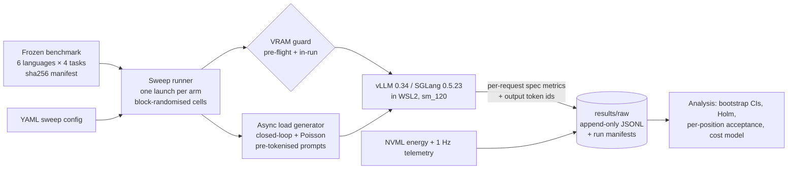

# IndicSpec

**Speculative decoding for Indic LLM serving.** How state-of-the-art drafters (EAGLE-3, DFlash, n-gram)
behave on Tamil, Telugu, Kannada, Malayalam and Hindi versus English, in production engines (vLLM, SGLang)
under load, on one 24 GB consumer Blackwell laptop GPU, and *why*, down to the byte level.

> **Status: work in progress (November 2026).** Infrastructure, mechanism analysis and engine bring-up are
> done; the pre-registered confirmatory measurements have not run yet. Every number below is labelled with
> what it is, and traces to a raw log or script in this repo (see [`docs/CLAIMS.md`](docs/CLAIMS.md)).
> Speed and acceptance only: **answer quality is not measured.**

---

## Why this matters

Indic users pay a **token tax**. For the same content, Qwen3 needs **6.2–7.3× more tokens** for Dravidian
languages than for English, so every answer takes several times longer and costs several times more to serve.
Speculative decoding is the standard lossless fix for decode latency, but its speed-up depends on how many
drafted tokens the target model accepts. This project measures whether that fix survives Indic scripts, and
explains the result.

## Findings so far

### 1. The token tax on Qwen3 (measured)

Same content (FLORES devtest, 220 parallel items per language), Qwen3 tokenizer, ratio of token counts vs English
with 95% bootstrap CIs ([`results/tables/token_tax.csv`](results/tables/token_tax.csv)):

| | en | hi | ta | te | kn | ml |
|---|---|---|---|---|---|---|
| Tokens vs English | 1.00 | 4.46 [4.38, 4.54] | 6.18 [6.06, 6.30] | 7.02 [6.88, 7.15] | 6.95 [6.81, 7.09] | **7.31** [7.17, 7.46] |
| Tokens per word | 1.26 | 4.78 | 10.14 | 11.41 | 11.85 | **13.43** |

Side finding: **Qwen3 ships exactly the Qwen2.5 tokenizer** (identical vocab and all 151,387 merges; only 4 new
special tokens), so published Qwen2.5 token-tax figures carry over, and ours independently reproduce them.

### 2. Most Dravidian tokens are fragments of a character (measured)

Qwen3 is byte-level BPE. Its 151k vocabulary contains only **14 whole Telugu characters** (Tamil 28, Kannada 25,
Malayalam 32) and **zero** multi-character Dravidian tokens. So most Dravidian letters are emitted as partial
UTF-8 byte sequences ([`results/tables/fragmentation_ref.csv`](results/tables/fragmentation_ref.csv)):

| | en | hi | ta | kn | ml | te |
|---|---|---|---|---|---|---|
| Share of tokens that are character fragments | 0.0% | 52% | 64% | 71% | 74% | **81%** |

### 3. Pruned-vocabulary drafters hit a hard ceiling (measured upper bound)

EAGLE-3 heads draft over a pruned 32k-token vocabulary. Reading the draft↔target id maps straight from the
checkpoints: both public Qwen3-8B heads can propose **~0% of the tokens that *start* a Dravidian character**
(and 91–100% of the tokens that complete one). An oracle drafter that is perfect whenever the token is in its
vocabulary is therefore capped at ([`results/tables/oracle_tau_bound.csv`](results/tables/oracle_tau_bound.csv)):

| Acceptance-length ceiling (tokens per target step) | en | hi | ta | te | kn | ml |
|---|---|---|---|---|---|---|
| English EAGLE-3 head, 3 draft tokens | 3.51 | 2.89 | **1.46** | 1.63 | 1.53 | 1.66 |
| English EAGLE-3 head, **7** draft tokens | 6.05 | 4.09 | **1.46** | 1.64 | 1.53 | 1.66 |
| Hindi/Gujarati EAGLE-3 head, 7 draft tokens | 6.52 | 7.87 | 1.63 | 1.75 | 1.61 | 1.75 |
| Any full-vocabulary drafter, 7 draft tokens | 7.55 | 7.88 | 7.91 | 7.92 | 7.92 | 7.93 |

Drafting more tokens does not help at all on Dravidian text: every character boundary cuts the run. A head
whose vocabulary was rebuilt for Hindi covers 100% of Hindi tokens but does **not** transfer to Dravidian scripts.
These ceilings are computed on reference text; whether real drafters sit near them is what the engine runs test.

### 4. Drafters configured correctly before comparing (verified)

A drafter only counts if it reproduces its authors' English behaviour on this hardware. On English probe
prompts, DFlash reaches acceptance length **5.51 on Qwen3-8B in both vLLM and SGLang** (authors report 4.9 mean);
the Red Hat EAGLE-3 head reaches **2.68** (card: 2.13–2.48). Smoke tests on Indic prompts point to a large gap
even for the full-vocabulary drafter, but that is **not** a result yet; it is what the confirmatory runs test.

## Engineering



What a systems reviewer may want to check:

- **Measured where it matters.** Both engines report speculative counters *per request* (vLLM
  `metrics.speculative_decoding`, SGLang `sglext.spec_tokens_details`), so acceptance is per language, not
  pooled. Engines define "acceptance length" differently (SGLang's own value read 5.72 where its raw counters
  give 5.51), so every τ is recomputed from raw counters as `(accepted + steps) / steps`.
- **Engine-truth per-position analysis.** With vLLM's per-step accept counts plus streamed output token ids, the
  harness reconstructs which token each rejection happened on, with alignment verified against token counts,
  so "did the drafter fail on a token outside its vocabulary?" is answered from the production engine, not a
  re-implementation.
- **No OOM, no silent spill.** On Windows/WSL the driver can spill VRAM into system RAM, which silently corrupts
  timing. A guard refuses launches that do not fit in free VRAM and flags any run whose peak reaches the ceiling;
  it caught SGLang at 24.1 / 24.5 GB and forced a fix.
- **Fair comparisons.** Same prompts, same pre-tokenised inputs, same `max_num_seqs`, same memory policy for
  every arm including the baseline; repeats run in seeded shuffled order so laptop thermal drift cannot align
  with one arm; GPU energy per cell from the NVML counter. Draft lengths will be tuned per arm on a split that
  is disjoint from the reported one (planned).
- **Reproducible and auditable.** Pinned model/drafter/dataset revisions, checksummed benchmark rebuilt by
  `make data`, engine lockfiles, a run manifest per launch, and a claim ledger with the status of every cited
  number. Decision thresholds go into [`docs/PREREG.md`](docs/PREREG.md), which is frozen in git *before* the
  confirmatory experiments run (currently a draft awaiting the pilot).

Bring-up notes from this machine (all in [`docs/ENGINE_STATUS.md`](docs/ENGINE_STATUS.md) and
[`docs/DECISIONS.md`](docs/DECISIONS.md)):

- Qwen3-8B + an EAGLE-3 head left **0.35 GiB** of KV cache on 24 GB with default `max_num_seqs`; capping it at the
  design's maximum concurrency (32) for every arm fixed it.
- SGLang's `--mem-fraction-static` covers weights + KV only; CUDA graphs and activations come on top, so it needs
  far more headroom than vLLM's `gpu_memory_utilization`.
- The public English EAGLE-3 head uses the *speculators* format with `norm_before_residual: true`; SGLang 0.5.23
  does not implement that variant, so converting the checkpoint would silently run a different network. It is
  measured on vLLM only.
- vLLM 0.34's v2 model runner needs `VLLM_WSL2_ENABLE_PIN_MEMORY=1` under WSL2; SGLang needs its venv on `PATH`
  to JIT-compile kernels with `ninja`.

### Engine × drafter status on an RTX 5090 Laptop GPU (sm_120)

| Arm | vLLM 0.34.0 | SGLang 0.5.23 |
|---|---|---|
| A0 no speculation (Qwen3-4B, 8B) | ✅ ✅ | ✅ ✅ |
| A1 engine n-gram | ✅ | ✅ |
| A3 `RedHatAI/Qwen3-8B-speculator.eagle3` (English, pruned vocab) | ✅ | ❌ unsupported variant (documented) |
| A4 `SwitchXDDD/multilingual-eagle3-qwen3-8b` (Hindi/Gujarati, pruned vocab) | ✅ | ✅ |
| A5 `z-lab/Qwen3-{4B,8B}-DFlash-b16` (full vocab) | ✅ ✅ | ✅ ✅ |

## Hardware and software

NVIDIA GeForce RTX 5090 Laptop GPU (24,463 MiB, compute capability 12.0, 150 W enforced limit), Intel Core Ultra 9
275HX, 64 GB RAM, Windows 11 + WSL2 Ubuntu 24.04, driver 610.88, CUDA 13.0 torch builds with native `sm_120`.
Targets in bf16: Qwen3-4B and Qwen3-8B at pinned revisions ([`configs/models.yaml`](configs/models.yaml)).

## Reproduce

```bash
make env-report      # hardware/software probe -> env/probe.json
make test            # CPU unit + property tests (CI runs these)
make data            # rebuild IndicSpec-Bench from pinned sources and verify sha256 against data/MANIFEST.json
bash env/install_engines.sh all                  # [WSL] vLLM and SGLang in separate venvs
bash scripts/smoke.sh vllm A5 qwen3-8b           # [GPU] one arm, six languages
bash scripts/sweep.sh configs/pilot_vllm_4b.yaml # [GPU] a full sweep (resumable)
```

## Repository map

| Path | What |
|---|---|
| [`src/indicspec/tokens/`](src/indicspec/tokens) | byte-level BPE decoding, token-class classifier, EAGLE-3 draft-vocab extraction, numpy safetensors reader |
| [`src/indicspec/harness/`](src/indicspec/harness) | server launcher, VRAM guard, async load generator, sweep runner, Prometheus scraper, telemetry, equality checker |
| [`src/indicspec/analysis/`](src/indicspec/analysis) | token tax, coverage, oracle ceiling, per-position acceptance, graft checks, pilot noise, bootstrap/Holm, cost model |
| [`src/indicspec/data/`](src/indicspec/data) | benchmark builders (FLORES via IndicGenBench, XQuAD-IN, Belebele, Aya) |
| [`docs/`](docs) | claim ledger, pre-registration, decisions log, novelty log, engine status, references, plan |
| [`results/`](results) | raw logs (append-only) and generated tables |

## Roadmap

- [x] Environment probe, scaffold, CI, claim ledger
- [x] IndicSpec-Bench: 6 languages × 4 tasks, parallel items, pilot/tuning/report splits, checksummed
- [x] Token tax, fragmentation, draft-vocab coverage, oracle ceiling (reference text)
- [x] Engine bring-up on `sm_120`, smoke matrix, English configuration checks (Gate G0 passed)
- [ ] Pilot → freeze pre-registered thresholds (**running now**)
- [ ] Confirmatory sweeps: acceptance and speed-up per language, concurrency 1–32, closed-loop + Poisson
- [ ] Coverage-split acceptance from engine traces; class-level acceptance (hypotheses H1–H3)
- [ ] Load crossover per language (H4); profiling-backed cost model (Nsight)
- [ ] Greedy-equality and sampling-distribution correctness suite on every reported arm
- [ ] Conditional on the gates: byte-aware n-gram drafter; UTF-8-validity draft mask

## Related work

Closest prior work: phrase-level speculative decoding with Telugu/Kannada/Hindi results on Qwen3-4B
([arXiv 2611.12464](https://arxiv.org/abs/2611.12464)); dictionary n-gram drafting for high-fertility scripts
([DictSpec, UNLP 2026](https://aclanthology.org/2026.unlp-1.15/)); a Hindi/Gujarati EAGLE-3 head
([SwitchXDDD](https://huggingface.co/SwitchXDDD/multilingual-eagle3-qwen3-8b)); SPEED-Bench
([arXiv 2604.09557](https://arxiv.org/abs/2604.09557)); DFlash ([arXiv 2602.06036](https://arxiv.org/abs/2602.06036)).
This project differs by evaluating the drafters people deploy, in production engines under load, on all four
Dravidian languages with parallel content, and explaining results at the byte level. Search log:
[`docs/NOVELTY_LOG.md`](docs/NOVELTY_LOG.md).

## Limitations

One GPU class (consumer Blackwell laptop, power-capped), one model family (Qwen3, two sizes), speed and acceptance
only (no quality evaluation), and early results computed on reference text rather than model generations. Machine-
translated chat prompts carry translationese risk and await native-speaker review.

## Licence and citation

Licence: to be chosen. Until a `LICENSE` file is added, default copyright applies. Benchmark sources keep their
own licences (CC-BY-SA-4.0, Apache-2.0); this repo ships builder scripts and checksums, not their text.
Citation metadata: [`CITATION.cff`](CITATION.cff).
