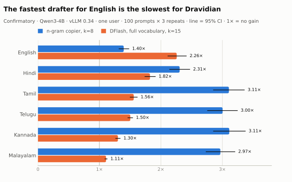
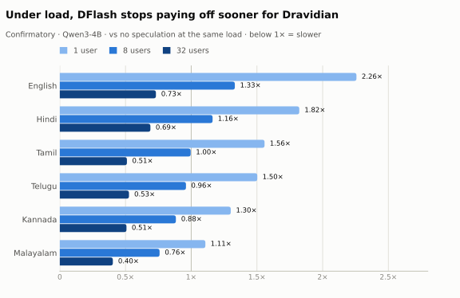
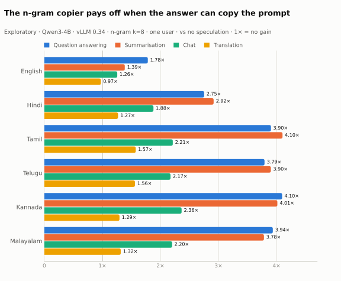
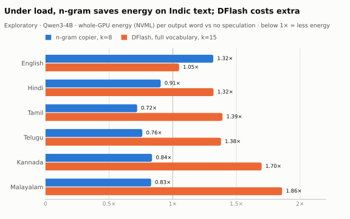

# Interim results: speculative decoding on Indic languages, Qwen3-4B

*IndicSpec interim note, 2026-11-27. Qwen3-4B results only; the Qwen3-8B sweep is still running. Every
number below has a row in [CLAIMS.md](../CLAIMS.md) (C52–C58). The tests and decision rules were fixed in
advance in [PREREG.md](../PREREG.md) (frozen at commit 6023a78, plus two dated amendments).*

## The question

Speculative decoding makes LLM serving faster by having a cheap *drafter* guess several tokens that the
big model then checks in one pass. Published speed-ups are measured almost entirely on English. Indian
languages are tokenised very differently: the same content needs 4.5× (Hindi) to 7.3× (Malayalam) as
many Qwen3 tokens as English, and 64–81% of Dravidian tokens are fragments of a character
([C19, C22](../CLAIMS.md)). We asked whether the drafters that work for English still work there.

## Setup

- **Model and engine:** Qwen3-4B on vLLM 0.34.0, one RTX 5090 Laptop GPU (24 GB, locked to 175 W),
  greedy decoding, bf16.
- **Prompts:** 100 held-out prompts per language (QA, summarisation, chat, translation) in English,
  Hindi, Tamil, Telugu, Kannada and Malayalam, 3 repeats each.
- **Load:** 1 to 32 simultaneous users. In total 32,400 requests were measured; no cells were excluded.
- **Drafters:** two, each tuned on a separate split before the report data was collected.
  - **n-gram copier, k=8:** guesses by copying text that already appears in the prompt.
  - **DFlash, k=15:** a trained neural drafter that uses the full vocabulary.
- **Speed-up:** tokens per second relative to no speculation, paired by prompt, with 95% bootstrap
  confidence intervals.

## Findings

**1. The fastest drafter for English is the slowest for Dravidian languages.**

| Speed-up at 1 user (95% CI) | en | hi | ta | te | kn | ml |
|---|---|---|---|---|---|---|
| n-gram copier | 1.40 [1.31, 1.48] | 2.31 [2.14, 2.47] | 3.11 [2.85, 3.36] | 3.00 [2.75, 3.25] | 3.11 [2.85, 3.38] | 2.97 [2.73, 3.21] |
| DFlash | 2.26 [2.11, 2.42] | 1.82 [1.74, 1.91] | 1.56 [1.49, 1.62] | 1.50 [1.46, 1.54] | 1.30 [1.26, 1.34] | 1.11 [1.09, 1.13] |

DFlash's guesses are accepted only about half as often in Dravidian languages as in English: 0.46–0.66 of
the English acceptance length. The n-gram copier's are accepted about 2.5× as often. With 7× more tokens per
word, a Dravidian answer repeats long runs of the prompt's tokens, which is exactly what a copier
predicts well.

**2. Under load, the neural drafter stops paying off much sooner for Dravidian languages.**

Speculation spends spare GPU capacity, and with more users there is less to spare. DFlash becomes a net
slowdown at 8 users for Telugu, Kannada and Malayalam, at 16 for Tamil, and only at 32 for English.
At 32 users it runs Malayalam at 0.40× the speed of no speculation. The n-gram copier still helps
every Dravidian language at 32 users (1.19–1.52×), but slows English from 8 users onward.

**3. The copier's gain depends on the task** (exploratory).

The copier's gain is largest when the answer can reuse the prompt's words. On Dravidian languages it reaches
3.8–4.1× for QA and summarisation and 2.2–2.4× for chat. For translation, where the output is in a
different language from the source, it falls to 1.3–1.6×, and to 0.97× for English.

**4. Energy follows speed** (exploratory).

At 16 users DFlash uses 1.38–1.86× the GPU energy per Dravidian output word, while the copier saves 16–28%.
The language gap is large even without speculation: at one user, 100 Malayalam words cost 2,502 J against
274 J for English.

**5. The pattern holds on a second engine.** On SGLang 0.5.23 (exploratory, 50 prompts per language),
DFlash's acceptance length matches vLLM's to within 0.04 in every language. The n-gram copier again favours
Dravidian languages, at 1.7–1.9× against 0.97× for English. One pitfall surfaced along the way: SGLang's
n-gram drafter keeps a server-wide memory of earlier requests. That memory inflated a repeated-prompt
benchmark from 0.97× to 3.8× on English until the cache was flushed before each measurement
([D-023](../DECISIONS.md)).

## Verdicts against the pre-registration

| | Claim tested | Verdict (Qwen3-4B) |
|---|---|---|
| H1 | Pruned-vocabulary EAGLE-3 drafters collapse on Indic text | Needs Qwen3-8B (running) |
| H2 | Drafter acceptance is lower in Dravidian languages than in English | **Inconclusive**: true for DFlash, the opposite for n-gram |
| H3 | Acceptance is lowest on character-fragment tokens | **Inconclusive**: true for DFlash, false for n-gram |
| H4 | Speculation stops paying off at lower load for Dravidian languages | **Confirmed** |
| G1 | Is there a real language gap worth fixing? | **Yes** |
| G2 | Is the gap explained by the token-class mix? | **No** under the strict joint rule. Re-weighting explains DFlash's gap fully, but n-gram has no gap to explain |

"Inconclusive" here does not mean the data is weak: every confidence interval is tight. It means the two
drafters move in *opposite* directions, and the pre-registered rule asked for one answer covering both.

## Corrections and caveats

- **Correctness check.** Before collecting report data, we tested whether speculation changes the greedy
  output. Every drafter diverged on 36–48% of prompts, and so did the plain model with 16 requests in
  flight (47–48 of 120 prompts). All 241 divergences picked the model's 2nd- or 3rd-ranked token. This is
  bf16 rounding in batched computation, not a drafter bug. The near-tie threshold was amended before the
  report data existed (PREREG Amendment 2).
- **Scope.** One GPU, one model size so far, greedy decoding only, closed-loop load.
- **Energy** is the whole-GPU counter per measurement cell, idle gaps included.

## What comes next

- **Qwen3-8B confirmatory sweep** (about 15 GPU hours): tests H1 (pruned EAGLE-3 heads) and completes the
  G1/G2 gates across both models.
- **Optional extensions:** SGLang confirmatory runs, sampling (non-greedy) decoding, and a drafter
  designed for fragment-heavy scripts, if G3 is pursued.

Code, configs and raw logs: this repository. Reproduce every table above from the raw logs with
`bash scripts/reproduce.sh`.
